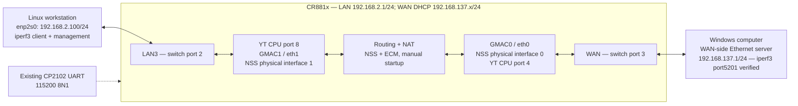

> Historical reference: measurements used the Kuncy7 foundation.

# CR881x wired NSS test topology

Validated 2026-11-01/02. The same wiring was tested on the original host path,
the experimental 802.1Q host path, and the NSS/ECM path. Wired NSS reached about
939 Mbit/s in each TCP direction. See [porting results](nss-kuncy-port.md).



Keep the existing workstation-to-LAN3 cable. Connect Windows Ethernet directly
to the CR881x WAN port. The router's WAN was initially down; during inspection
it acquired 192.168.137.152/24 from DHCP server/gateway 192.168.137.1, with
mshome.net. This is consistent with Windows Internet Connection Sharing;
the iperf3 endpoint at that address is now verified. Preserve that working
DHCP arrangement rather than replacing it with a new static subnet. After
the Windows driver replacement, the router renewed its WAN lease as
192.168.137.90/24. Its address changed again during later test reboots. Read
`ubus call network.interface.wan status` before adding address-scoped firewall
rules; substitute the live WAN address in the examples below.

The Linux workstation retains its Wi-Fi at 10.1.0.121 and its existing default
route. Its policy rule for destinations 192.168.2.0/24 selects table200, whose
192.168.2.1 path currently goes through Wi-Fi. Management uses the already
pinned-key Ethernet SSH proxy; do not change that policy as a testing side
effect. A separate host route to the WAN server is sufficient for benchmarks.
The user installed this route after the noninteractive sudo check showed a
password was required. Its effective path has been verified through enp2s0;
no namespace was created.

## Installed workstation test route

To recreate the user-installed route locally with sudo (never send a password
to the agent):

```sh
sudo ip -4 route add 192.168.137.1/32 via 192.168.2.1 dev enp2s0 src 192.168.2.100
ip -4 route get 192.168.137.1 from 192.168.2.100
```

The result must show `via 192.168.2.1 dev enp2s0`, not Wi-Fi. If a host route
already exists, inspect it instead of replacing it blindly. This adds only
the test server's /32 route to the main table; it does not change either
default route or the management policy rule.

Remove only that exact route after testing:

```sh
sudo ip -4 route del 192.168.137.1/32 via 192.168.2.1 dev enp2s0
```

## Windows endpoint — server confirmed ready

Confirm the Ethernet address with `ipconfig`. With iperf3 already available,
run in its directory and leave the window open:

```powershell
.\iperf3.exe -s -B 192.168.137.1
```

If Windows Firewall blocks the server, use an administrator PowerShell to add
rules confined to this local address and the router's current WAN address:

```powershell
New-NetFirewallRule -DisplayName "CR881x iperf TCP" -Direction Inbound -Action Allow -Protocol TCP -LocalPort 5201 -LocalAddress 192.168.137.1 -RemoteAddress 192.168.137.90 -Profile Any
New-NetFirewallRule -DisplayName "CR881x iperf UDP" -Direction Inbound -Action Allow -Protocol UDP -LocalPort 5201 -LocalAddress 192.168.137.1 -RemoteAddress 192.168.137.90 -Profile Any
```

Remove those named rules afterwards. If the WAN DHCP address changes, refresh
the remote-address scope; do not widen it to all networks. LAN-to-WAN forwarding
and WAN masquerading are already configured on the router, so Windows receives
test traffic from 192.168.137.90. No additional router firewall opening or
Windows route back to 192.168.2.0/24 is needed for these NAT tests.

## First checks and measurements

Linux has iperf3 and tcpdump installed. The router needs no iperf3 server: both
traffic endpoints are external, forcing traffic across its forwarding path.
After route and Windows server readiness, run:

```sh
iperf3 -c 192.168.137.1 -B 192.168.2.100 -t 30 -O 3
iperf3 -c 192.168.137.1 -B 192.168.2.100 -t 30 -O 3 -R
```

The first sends LAN-to-WAN; `-R` sends WAN-to-LAN over the client-established
connection. Capture both router conduits, record CPU load and counters, and
save results for the same topology/configuration at each stage. Start with
single-stream TCP. Add parallel streams or controlled UDP only after basic
correctness and endpoint capacity are established.

1. Current baseline firmware, original tagger, NSS off.
2. New image, original tagger, NSS off.
3. Experimental standard 802.1Q transport, host path only.
4. Same transport with explicitly armed NSS wired forwarding.

For stage4, throughput alone is insufficient: require rule ACK, increasing
bidirectional accelerated counters and correct ingress/egress tags, with no
unexplained exception/fallback activity. Later QinQ and ath11k NSS tests are
separate work. Add a second LAN endpoint for LAN-to-LAN/VLAN isolation tests;
the current two-computer topology proves routed LAN/WAN behavior only.

Read-only evidence: `logs/nss-test-topology-20261101/`. The agent changed no router configuration, firmware, route or firewall. The
user added the one test-server /32 workstation route. The existing WAN DHCP
lease and NAT/firewall settings were retained.

## Verified setup result

Both LAN3 and WAN negotiated 1000Mb/s full duplex. The exact workstation route
lookup for 192.168.137.1 from 192.168.2.100 selects 192.168.2.1 via enp2s0.
Two 3-second TCP checks, each capped at 10Mbit/s, passed: about 10.13Mbit/s
LAN-to-WAN and 10.13Mbit/s WAN-to-LAN, with 3,801,088 received bytes each.
These are connectivity checks, not maximum-throughput measurements.

Paired LAN3/WAN header captures show the same TCP SYN sequence and source
port changing from 192.168.2.100 on LAN to 192.168.137.152 on WAN, confirming
that the CR881x performs the NAT forwarding. Both captures report zero kernel
drops. NSS modules were absent during the checks. The topology is ready for
recording the full-rate original-mode baseline before any firmware change.

## Full-rate original-mode baseline (2026-11-01)

The current firmware was tested with NSS and nftables flow offload inactive.
Each case used 30 measured seconds after 3 seconds of warmup, with TCP rate
unlimited. These are single runs for reference, not statistical benchmarks.

| Direction | One stream | Four streams | Router CPU observation |
| --- | ---: | ---: | --- |
| LAN to WAN | 357.2 Mbit/s | 288.1 Mbit/s | Core1 saturated in both cases |
| WAN to LAN | 217.5 Mbit/s | 215.7 Mbit/s | About18% aggregate busy |

The reverse limiting factor remains unresolved; it cannot be attributed to
router CPU capacity from these measurements. Windows CPU and direct endpoint
capacity were not measured. Forward retransmission counts were zero; the
Windows sender did not supply reverse retransmission counts.

Exposed interface error/drop counters and driver error telemetry did not
increase, and there were no new kernel messages. Configuration hashes and
boot identity stayed unchanged. Full CPU/counter results, commands and raw
iperf3 JSON are in `logs/nss-baseline-20261101/RESULT.md` and `baseline.json`.
The router lacks tc; its queue configuration was not inspected with that tool.
No package, firmware or configuration changes were made for these tests.

## UDP check of the Windows-sender limit (2026-11-01)

Reverse UDP used one stream,1400-byte payloads and10-second runs without
omitted warmup. At400Mbit/s requested, Windows reported214.7Mbit/s sent and
Linux received212.2Mbit/s, with router CPU about12% busy. UDP did not exceed
the reverse TCP result. This weakens a TCP-only explanation; endpoint/NIC
behavior and path backpressure or burst loss remain possible.

WAN rx_dropped increased during the UDP probes. iperf's reported loss does
not match the full sender/receiver byte deficit, so both metrics are retained.
The first omit2 UDP run had mismatched timing windows and was excluded.
Details: `logs/nss-udp-20261101/RESULT.md` and `udp.json`. No firmware,
configuration, firewall, route or offload setting was changed.

## Baseline after the Windows driver switch (2026-11-01)

The user replaced rt25cx21x64.sys1125.12.320.2023 with
rt640x64.sys10.80.50.407. The router renewed WAN as192.168.137.90; its boot
identity and configuration hashes stayed the same. NSS remains off.

| Direction | Streams | Before | After |
| --- | ---: | ---: | ---: |
| LAN to WAN | 1 | 357.2 Mbit/s | 529.8 Mbit/s |
| WAN to LAN | 1 | 217.5 Mbit/s | 513.2 Mbit/s |
| LAN to WAN | 4 | 288.1 Mbit/s | 389.7 Mbit/s |
| WAN to LAN | 4 | 215.7 Mbit/s | 488.2 Mbit/s |

The router's core1 is now close to or at full use in TCP measurements.
Windows also sends the requested400Mbit/s UDP rate after the switch, but LAN
receives344.0Mbit/s with13.95% reported loss. That lossy UDP result is not a
clean throughput-capacity benchmark. Small RX-drop increases occurred on the
GMAC netdevs during reverse TCP; full counter details are retained.

Use this post-driver dataset for future comparisons. Exact Realtek root cause
and the remaining UDP loss are not isolated. Each case is a single run.
Details: `logs/nss-driver-retest-20261101/RESULT.md` and `comparison.json`.
